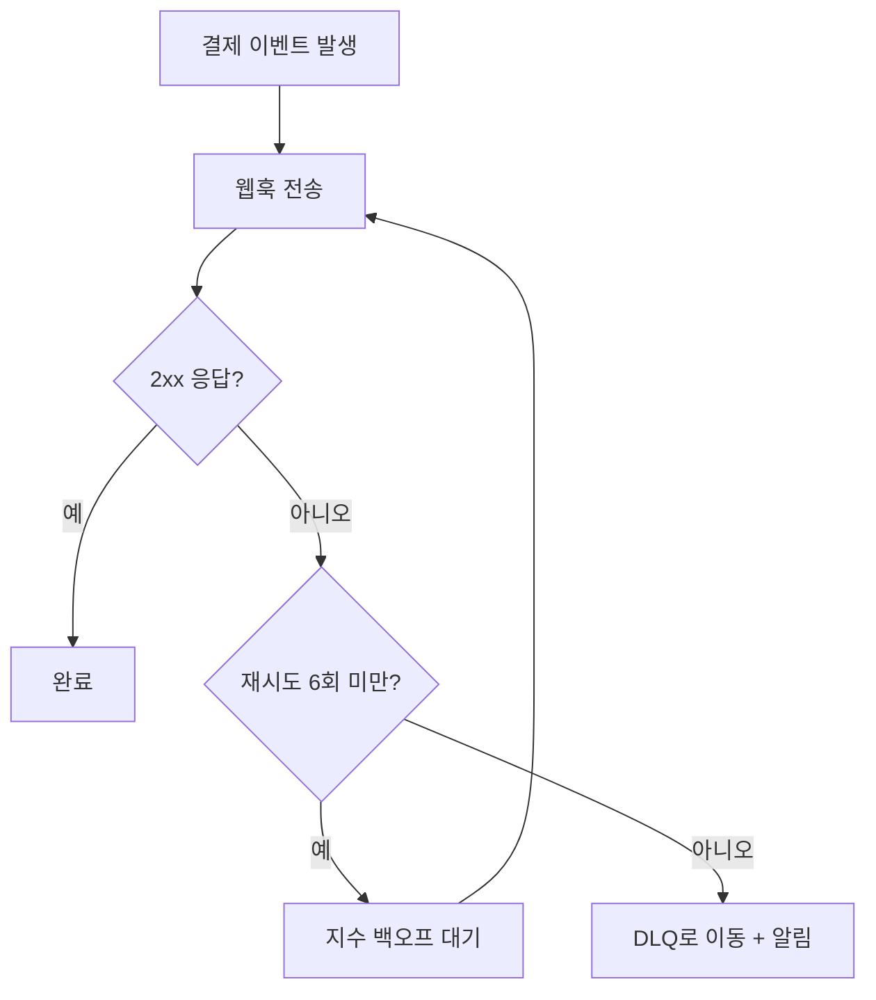

# 결제 서비스 v2.4 릴리스 노트

이번 릴리스는 **정산 파이프라인 재설계**와 **웹훅 재시도 로직**이 핵심입니다.
아래 문서는 배포 전 리뷰용으로 정리했습니다. 궁금한 점은 `#pay-platform` 채널로.

> [!important] 배포 창(window)
> **2026-07-01 02:00 ~ 03:00 KST**. 이 시간대에 결제 승인 지연이 최대 30초 발생할 수 있습니다.

---

## 한눈에 보기

| 영역 | 변경 | 영향도 | 롤백 |
| :--- | :--- | :---: | :---: |
| 정산 배치 | 시간당 → 실시간 스트리밍 | 높음 | 가능 |
| 웹훅 | 지수 백오프 재시도 도입 | 중간 | 가능 |
| 관리자 API | `GET /v2/settlements` 추가 | 낮음 | 불필요 |
| DB 스키마 | `settlement_events` 테이블 신설 | 높음 | **불가** |

> [!warning] 스키마 마이그레이션은 되돌릴 수 없습니다
> `settlement_events`는 배포와 함께 생성됩니다. 롤백 시 데이터 정합성 수동 확인이 필요합니다.

---

## 무엇이 바뀌나

- [x] 정산 배치를 실시간 스트리밍으로 전환
- [x] 웹훅 실패 시 지수 백오프(최대 6회) 재시도
- [x] 관리자용 정산 조회 API 추가
- [ ] 정산 리포트 CSV 내보내기 *(다음 릴리스로 이월)*
- [ ] 다중 통화 정산 *(설계 단계)*

### 재시도 백오프 계산

재시도 간격은 지터를 더한 지수 백오프를 씁니다.

$$
\text{delay}(n) = \min\left(2^{n} \cdot b,\; T_{\max}\right) + \text{jitter}, \quad b = 500\text{ms},\; T_{\max} = 30\text{s}
$$

즉 첫 재시도는 약 $2^1 \cdot 500\text{ms} = 1\text{s}$, 여섯 번째는 상한 $T_{\max}$에 걸립니다.

---

## 웹훅 재시도 흐름



---

## 적용 코드

핵심 재시도 로직입니다. 프로덕션 반영 전 꼭 리뷰해주세요.

```typescript
const BASE_MS = 500;
const MAX_MS = 30_000;
const MAX_RETRY = 6;

/** 지수 백오프 + 지터. n은 1부터 시작하는 재시도 횟수. */
function backoffDelay(n: number): number {
  const exp = Math.min(2 ** n * BASE_MS, MAX_MS); // 상한 클램프
  const jitter = Math.random() * 250;             // thundering herd 방지
  return exp + jitter;
}

export async function deliverWebhook(evt: PaymentEvent): Promise<void> {
  for (let n = 1; n <= MAX_RETRY; n++) {
    const res = await post(evt.url, evt.payload);
    if (res.ok) return;                 // 2xx면 성공
    await sleep(backoffDelay(n));       // 실패 → 백오프 후 재시도
  }
  await moveToDeadLetter(evt);          // 6회 초과 → DLQ
}
```

> [!tip] 지터를 왜 넣나요?
> 동시에 실패한 수천 건이 같은 순간에 재시도하면 서버가 다시 죽습니다(thundering herd).
> 무작위 지터가 재시도 시점을 흩뜨려 이 문제를 막습니다.

---

## 배포 체크리스트

1. 스테이징에서 마이그레이션 리허설
   - [x] `settlement_events` 생성 확인
   - [x] 롤백 스크립트 검증
2. 카나리 10% 트래픽으로 30분 관찰
3. 지표 이상 없으면 100% 전환

배포 자동화는 [배포 파이프라인 문서](https://example.com/deploy)를 참고하세요.

---

여기까지 확인하셨으면 `#pay-platform`에 👍 남겨주세요. 리뷰 감사합니다.
